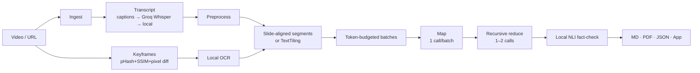

# LectureLens 🎓

**Multimodal (speech + slide) summarization of educational videos, on free tiers only.**

LectureLens turns a lecture video (local file or YouTube URL, including 1–3 h lectures) into a summary, key points with timestamps, study notes with slide thumbnails, glossary, chapters and a quiz. Every key point is **fact-checked locally** against the transcript and slides. Slides are read with **local OCR**, so content that is shown but never spoken still reaches the notes.

- Free tier only: Gemini 3.5 Flash-Lite / Groq free tier, with local fallbacks (faster-whisper, Ollama, TextRank). No billing is ever needed.
- A 60-minute lecture needs **≤ 15 LLM calls** (typically 3–5 on Gemini), and frames are never sent to an LLM.
- Quota-aware: a persistent usage ledger, client-side throttling, backoff, provider fallback, a pre-flight estimate and **resumable runs**.
- Paper-ready evaluation: 4 systems, ROUGE / BERTScore / concept coverage / slide-concept recall / faithfulness / cost, LaTeX tables and 300-dpi figures.

---

## Demo in 3 commands

```bash
pip install -r requirements.txt                       # after creating a venv (below)
python -m lecturelens run "https://www.youtube.com/watch?v=<id>"
streamlit run app.py
```

---

## 1. Setup

### Windows (PowerShell)
```powershell
winget install ffmpeg                       # then open a NEW terminal
py -3.11 -m venv .venv
.venv\Scripts\activate
pip install torch --index-url https://download.pytorch.org/whl/cpu   # CPU-only torch (~200 MB instead of ~2.5 GB)
pip install -r requirements.txt
copy .env.example .env                      # then edit .env
```

### macOS / Linux
```bash
brew install ffmpeg            # macOS   |  sudo apt install ffmpeg   (Debian/Ubuntu)
python3 -m venv .venv && source .venv/bin/activate
pip install torch --index-url https://download.pytorch.org/whl/cpu
pip install -r requirements.txt
cp .env.example .env
```

Python 3.10–3.12, CPU only, 8 GB RAM is enough. Node.js (or Deno) on the PATH helps yt-dlp with YouTube.

### Free API keys (both optional)
| Key | Where | Used for |
|---|---|---|
| `GEMINI_API_KEY` | [Google AI Studio](https://aistudio.google.com) → **Get API key** (no billing) | primary LLM (`gemini-3.5-flash-lite`) |
| `GROQ_API_KEY` | [console.groq.com](https://console.groq.com) → **API Keys** | Whisper ASR + fallback LLM (`openai/gpt-oss-120b`) |

Put them in `.env`. Keys are never logged or printed. **With no keys at all** it still works: local Whisper ASR, plus Ollama if it is running (`ollama pull qwen2.5:7b`); with no LLM it produces an extractive TextRank summary and a notes skeleton, and says so.

### Your real free-tier limits
Google no longer publishes fixed free-tier numbers. Check them per project in **AI Studio → your project → Rate limits**, and for Groq at **console.groq.com/settings/limits**. Then edit `quota.limits` in `config.yaml`. The defaults are deliberately pessimistic (e.g. Gemini Flash-Lite: 10 RPM, **20 requests/day**).

**Models change.** Providers retire free models without notice (in Nov 2026, `gemini-2.5-flash-lite` returned *"no longer available to new users"* and Groq dropped `llama-3.3-70b-versatile`). `python -m lecturelens models` checks your configured models; fix any failure by editing `llm.*.model` in `config.yaml`. For Groq, you can read your real limits from the `x-ratelimit-limit-*` response headers (gpt-oss-120b: 1,000 requests/day, 8,000 tokens/min).

```bash
python -m lecturelens models   # do the configured models exist for your keys?
python -m lecturelens quota    # today's usage, what's left, when it resets (Gemini: midnight Pacific)
```

### First-run model downloads (cached afterwards)
| Model | Size | Purpose |
|---|---|---|
| faster-whisper `base` (`small`: ~460 MB) | ~145 MB | local ASR fallback |
| EasyOCR detector + recognizer | ~95 MB | slide OCR |
| `all-MiniLM-L6-v2` | ~90 MB | topic segmentation, evidence retrieval, concept matching |
| `cross-encoder/nli-deberta-v3-xsmall` | ~280 MB | fact-checking (NLI) |
| `distilbert-base-uncased` | ~260 MB | BERTScore (evaluation only) |
| nltk `punkt_tab` | ~15 MB | sentence splitting |

---

## 2. Usage

### CLI
```bash
python -m lecturelens preflight <file_or_url>   # estimate calls/tokens/time vs. today's quota (no LLM calls)
python -m lecturelens run <file_or_url>         # full pipeline
python -m lecturelens run lecture.mp4 --no-slides          # speech only
python -m lecturelens run <url> --providers groq,ollama    # override LLM order
python -m lecturelens runs                      # history (paused runs show their resume command)
python -m lecturelens resume <run_id>           # continue a paused run; completed calls are never repeated
python -m lecturelens quota
```
Outputs go to `runs/<slug>_<hash>/`: `lecture.md`, `lecture.pdf` and `lecture.json`, plus every intermediate artifact and `run_log.json` (per-stage timings, provider/model, tokens, calls, retries, fallbacks, config snapshot).

**When the quota runs out mid-run**, LectureLens saves everything and exits with code 3 and a message like `Resume with: python -m lecturelens resume <run_id> (daily resets — gemini: 2026-11-07 13:30)`.

### Streamlit app
```bash
streamlit run app.py
```
The sidebar shows which keys were found, provider order, today's quota usage, OCR on/off, transcript source and run history (with a **Resume** button for paused runs). Paste a URL or upload a file to get a pre-flight estimate, then press Summarize to see live per-stage progress, with a countdown during rate-limit pauses. The tabs are **Summary · Key Points** (✅/⚠️ badges, evidence, clickable timestamps that seek the player) **· Study Notes** (with slide thumbnails) **· Slides · Quiz · Chapters · Transcript** (searchable) **· Analytics**. You can download Markdown, PDF or JSON.

### Evaluation
```bash
python -m lecturelens eval                  # data/videos.csv × 4 systems → results/<timestamp>/
python -m lecturelens eval --max-calls 10   # cap today's LLM usage
python -m lecturelens eval --resume         # continue tomorrow; cached results are reused
python -m lecturelens eval --provider groq  # same LLM for every LLM-based system
python -m lecturelens eval --wer            # also ASR-vs-human-captions WER
python -m evaluation.analyze_human_eval results/<timestamp>
```
- `data/videos.csv`: `id, url_or_path, subject, duration_min, has_slides`.
- `data/references/<id>.md`: **your human-written reference summary**. `<id>_concepts.txt`: key concepts, one per line. References are never generated by an LLM. Missing references mean the reference-based metrics are skipped for that video, and files marked `PLACEHOLDER` are flagged in the report.
- Output: `results.csv`, `summary_table.md/.tex`, `figures/*.png` (300 dpi), `report.md`, `human_eval_form.csv` (shuffled, anonymised) and `human_eval_key.csv`.
- Before running, the grid prints its total estimated calls against today's quota. If it doesn't fit, it runs what fits and tells you to `--resume` tomorrow.

### Tests
```bash
python -m pytest -q        # offline, mocked LLM: never uses the network or quota
```

### Synthetic sample
`python samples/make_synthetic_lecture.py` renders a 2-minute slide lecture with OS text-to-speech. Some slide bullets (e.g. *cosine annealing, Adam, RMSProp, momentum*) are deliberately never spoken, which makes it useful for testing RQ1 offline.

---

## 3. Architecture


More detail is in [`docs/architecture.md`](docs/architecture.md). The package has one module per stage: `ingest, audio, transcribe, preprocess, slides, ocr, segment, batching, summarize, verify, export`. Infrastructure lives in `quota, cache, llm, providers/`, and orchestration in `pipeline`.

---

## 4. Methodology (paper-ready)

**Speech.** If the video has human-made captions, we use them directly; WebVTT rolling-caption duplicates, markup and non-speech tags are removed. Otherwise audio is resampled to 16 kHz mono and transcribed with Whisper large-v3-turbo on Groq's free tier, falling back to faster-whisper (`base`, int8, CPU). Audio longer than 20 min is split into 10-min chunks with 3 s overlap. Chunk timestamps are offset, segments entirely inside the already-covered overlap are dropped, and words duplicated across the boundary are removed by longest suffix–prefix word match. Fillers and n-gram repetition loops are removed, and the text is sentence-split (Punkt). Each sentence gets start and end times by linear interpolation of word positions within its source segment.

**Slides.** Frames are sampled every 2 s at 640 px width. A slide boundary occurs where consecutive frames differ in perceptual hash (Hamming distance > 12), SSIM (< 0.80) or changed-pixel ratio (> 0.6 %); the last criterion separates slides that share a template. Runs shorter than 6 s (transitions, animations, presenter shots) are merged into the following slide, and visually identical neighbours are merged. For each slide, the sharpest frame (variance of the Laplacian) in its second half is re-extracted at native resolution and read with EasyOCR on CPU. OCR boxes below confidence 0.35 are dropped and the rest grouped into lines in reading order. The title is the tallest line in the top 35 % of the frame. Lines repeated on ≥ 60 % of slides (headers, footers, logos) and page numbers are removed. Consecutive slides whose text is ≥ 90 % similar, or whose tokens are a ≥ 90 % subset of their neighbour's (progressive bullet reveals), are merged. A video is in *low visual mode* when fewer than 3 slides contain ≥ 25 characters of text or text slides cover < 25 % of its duration.

**Alignment and segmentation.** In high visual mode, each sentence is assigned to the slide on screen at its temporal midpoint, giving *slide-aligned multimodal segments* (slide OCR text + co-occurring speech). Segments under 60 words are merged with a neighbour, and segments over 700 words are split at sentence boundaries. In low visual mode, the transcript is segmented by embedding TextTiling with all-MiniLM-L6-v2: the depth score at each sentence gap is computed from cosine similarity of mean embeddings of 6-sentence windows. Boundaries are placed where depth > μ + 0.5σ, with non-maximum suppression, or at YouTube chapter starts when available.

**Quota-aware hierarchical summarization.** Segments are rendered as `[SEGMENT k | mm:ss–mm:ss] SLIDE: … SPEECH: …` and packed in order into balanced batches under a per-call input budget (10 K tokens for Gemini; 3 K for Groq, so input plus `max_tokens` stays below its 8 K TPM). One *map* call per batch returns strict JSON per segment: title, summary, key points with evidence source (slide/speech/both), concepts, formulas/code, examples. If the concatenated map outputs exceed the reduce budget, they are condensed group-wise by recursive *group-reduce* calls; this is how 2–3 h lectures fit. A single final *reduce* call then produces the lecture-level summary, key points (with segment ids), study notes, glossary, chapters and 5 MCQ + 5 short-answer questions. On small-TPM providers this is split into two calls. Timestamps are derived from segment ids, never from model output. Outputs are validated with pydantic. Invalid JSON is first repaired locally (truncation closing), then with one repair call on a cheap model, and otherwise salvaged item by item. All prompts are versioned in `prompts/`.

**Verification.** Each key point is matched with candidate evidence: the top-k (k = 3) passages, which are 2-sentence transcript windows plus each slide's text, by MiniLM cosine similarity, both globally and within the key point's own segments, plus the concatenation of the top 3. Each pair is scored with the NLI cross-encoder `nli-deberta-v3-xsmall` (premise = evidence, hypothesis = key point). A point is *supported* if max P(entailment) ≥ 0.5, *unsupported* if P(contradiction) ≥ 0.6, and *uncertain* otherwise. Faithfulness is the percentage supported. Verification is fully local (0 API calls).

**Quota management.** A SQLite ledger records every request (provider, model, time, tokens, audio-seconds). Before each call, a sliding-window limiter (equivalent to a continuously refilled token bucket) waits until requests/min, tokens/min and audio-seconds/hour fit within a 0.9 safety factor of the configured limits. Daily caps reset at the provider's reset time (Gemini: midnight Pacific). A 429 with a per-day signature marks the model exhausted for the day. Short 429s and 5xx responses are retried with exponential backoff and jitter (honouring `retryDelay` / `retry-after`), then the request falls back to the next provider. All responses are cached by `sha256(provider, model, system, prompt, params)`, and every stage is cached in the run folder. When all providers are exhausted, the run is saved as *paused* and resumed without repeating any completed call.

**Evaluation.** The four systems all use the same LLM: (1) TextRank (TF-IDF graph, PageRank, ~220 words); (2) single-pass LLM over the whole transcript (speech only); (3) hierarchical, speech only; (4) LectureLens (hierarchical, speech + slides). The metrics are ROUGE-1/2/Lsum (Porter stemming); BERTScore P/R/F1 (`distilbert-base-uncased`, layer 5, chosen for CPU; the paper default is roberta-large); and concept coverage against human key-concept lists (stemmed phrase match, else MiniLM cosine ≥ 0.70 to any output n-gram). *Slide-concept recall* is the share of slide-only terms (OCR phrases/technical terms never spoken, by stemmed match) present in the output. Faithfulness is the NLI-supported share of summary sentences. We also report compression ratio, cost (LLM calls, tokens, wall-clock per stage) and ASR WER versus human captions.

---

## 5. Known limitations

- **OCR**: handwriting and whiteboards OCR poorly, so such videos fall back to speech-only mode. Code screenshots lose indentation and some symbols, and math formulas come out linearised (`L(w) = 1/n sum ...`). Tiny fonts at 480p may be missed; raise `ingest.max_height` if needed.
- **Slide detection** assumes mostly static slides. Live demos and screen recordings create many "slides", which are capped at `slides.max_slides_per_min`. Picture-in-picture presenters can split a slide if they move a lot.
- **YouTube**: private, members-only and region-blocked videos fail with a clear message. Age-restricted videos need `ingest.cookies_from_browser`. YouTube changes often, so keep `yt-dlp` updated (`pip install -U yt-dlp`). Auto-generated captions are off by default (`transcript.use_auto_captions`).
- **Faithfulness** uses a small NLI model: abstractive paraphrases that combine several sentences may score *uncertain*, and greetings or meta statements can't be entailed.
- **Token counts** in pre-flight are estimates (~4 chars/token); real usage from the API is recorded in the ledger.
- Free-tier limits change and differ per account: set yours in `config.yaml`.
- The local Whisper `base` model is fast but less accurate than Groq's large-v3-turbo; set `transcript.local_model: small` for better local ASR (about 3× slower).
