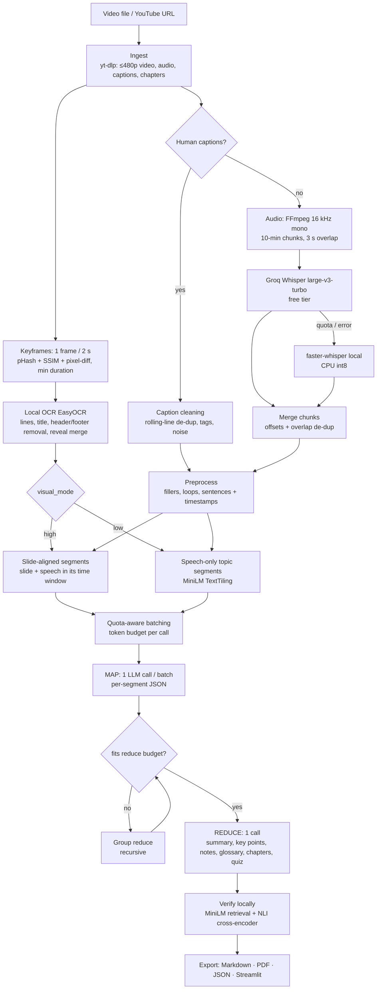
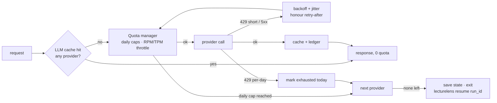

# LectureLens architecture

## Pipeline

## LLM call path (every request)

Provider chain: Gemini 3.5 Flash-Lite (free) → Groq `openai/gpt-oss-120b` (free) → Ollama (local) → extractive TextRank (no LLM).

## Run folder (`runs/<slug>_<hash>/`)

| File | Stage |
|---|---|
| `source.json`, `media/` | ingest |
| `transcript.json/.txt/.srt`, `asr/chunk_*.json` | transcript (per-chunk cache) |
| `sentences.json` | preprocess |
| `keyframes.json`, `keyframes/slide_*.png`, `thumb_*.jpg` | slide detection |
| `ocr_raw.json`, `slides.json` | OCR |
| `segments.json` / `segments_speech.json` | alignment / segmentation |
| `map/batches.json`, `map/batch_*.json`, `map/usage.jsonl` | map calls |
| `reduce/level*_group*.json`, `reduce/final.json`, `reduce/usage.jsonl` | reduce calls |
| `lecture.md`, `lecture.pdf`, `lecture.json` | export |
| `state.json`, `run_log.json` | status, timings, calls, tokens, config snapshot |
