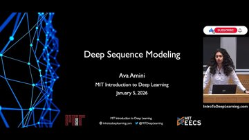
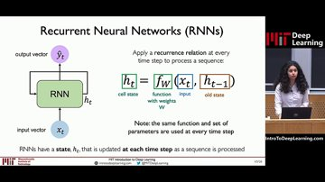

# MIT 6.S191: Recurrent Neural Networks, Transformers, and Attention

**Source:** MIT 6.S191: Recurrent Neural Networks, Transformers, and Attention · [YouTube](https://www.youtube.com/watch?v=d02VkQ9MP44) · **Duration:** 57:34 · **Faithfulness:** 50% of key points supported

## Summary

This lecture explores deep sequence modeling, contrasting time-resolved sequence processing with traditional feed-forward networks. Sequential data, such as audio, text, and financial time series, requires models that can capture temporal order, handle variable input lengths, and track long-term dependencies. The lecture first introduces Recurrent Neural Networks (RNNs), which maintain an internal hidden state updated step by step using shared parameters and tanh non-linearities. Although powerful for tasks like music generation and sentiment classification, RNNs suffer from training bottlenecks, including exploding and vanishing gradients during backpropagation through time, as well as an encoding bottleneck due to step-by-step sequential processing. To overcome these limitations, the lecture introduces the attention mechanism and transformer architecture. By leveraging query, key, and value transformations alongside scaled dot-product similarity and softmax attention weighting, self-attention allows models to process sequences all at once in parallel, capturing both local and global semantic relationships. This foundational attention operation drives modern transformer models like GPT, BERT, Vision Transformers, and protein structure predictors such as AlphaFold.

## Key points

- ✓ Sequence modeling requires a different way of thinking because data is resolved in time compared to feed-forward models. [0:00](https://www.youtube.com/watch?v=d02VkQ9MP44&t=0s) _[speech]_
- ? The cell state ht is a function defined by a set of weights w that depends on the input and the old state, computed as ht = tanh(Whh * ht-1 + Wxh * xt). [13:36](https://www.youtube.com/watch?v=d02VkQ9MP44&t=816s) _[both]_
- ✓ RNNs meet sequence modeling design criteria by handling variable-length sequences, tracking long-term dependencies, maintaining information about order, and sharing parameters across the sequence. [30:02](https://www.youtube.com/watch?v=d02VkQ9MP44&t=1802s) _[both]_
- ? In RNNs, error is backpropagated across individual time steps from the current position back to the beginning of the sequence, causing exploding or vanishing gradients due to repeated matrix multiplications. [31:38](https://www.youtube.com/watch?v=d02VkQ9MP44&t=1898s) _[both]_
- ? RNNs suffer from an encoding bottleneck imposed by compressing structural data into a single internal state variable, and step-by-step processing is slow and not parallelizable. [38:52](https://www.youtube.com/watch?v=d02VkQ9MP44&t=2332s) _[both]_
- ? Self-attention identifies and attends to the most important features in input data fed in all at once, functioning similarly to a search problem. [43:14](https://www.youtube.com/watch?v=d02VkQ9MP44&t=2594s) _[both]_
- ⚠ Query, key, and value matrices are generated by applying separate learned linear layers to sequence positional embeddings. [48:56](https://www.youtube.com/watch?v=d02VkQ9MP44&t=2936s) _[both]_
  - ⚠ *Not supported by the transcript/slides — check before relying on it.*
- ✓ Attention scores are computed using the scaled dot product between query and key matrices, followed by a softmax function to produce attention weights between zero and one. [49:36](https://www.youtube.com/watch?v=d02VkQ9MP44&t=2976s) _[both]_
- ✓ Multiple attention heads are highly parallelizable and can be stacked together within a network to identify different patterns of importance. [54:00](https://www.youtube.com/watch?v=d02VkQ9MP44&t=3240s) _[both]_
- ✓ Transformer-based attention architectures apply across multiple domains, including biological sequences (AlphaFold), computer vision (Vision Transformers), and natural language processing (GPT). [55:12](https://www.youtube.com/watch?v=d02VkQ9MP44&t=3312s) _[both]_

## Detailed summary

The lecture begins by introducing deep sequence modeling and contrasting it with standard feed-forward networks. While feed-forward models evaluate multi-dimensional inputs at a single time step without a notion of time or sequence, real-world data like audio waveforms, text, medical signals, videos, and weather are inherently sequential and resolved in time. Predicting the next element in a sequence without historical context is often a random guess, demonstrating the necessity of tracking past information.

To process sequential data, the lecture covers Recurrent Neural Networks (RNNs). RNNs introduce an internal state variable, denoted as ht, which is updated at every time step using the current input and the previous hidden state via a shared recurrence relation, ht = tanh(Whh * ht-1 + Wxh * xt). This architecture satisfies key sequence modeling criteria by inherently supporting variable-length sequences, maintaining positional order through step-by-step processing, and sharing parameters across the sequence. RNNs are applied to various many-to-many tasks, including sentiment classification, machine translation, and multi-output music generation such as finishing Schubert's unfinished symphony in software lab 1.

Despite their utility, standard RNNs face significant technical hurdles. During training via backpropagation through time (BPTT), gradients are propagated backward across time steps through repeated multiplications of weight matrices. Large weights can lead to exploding gradients, which are mitigated using gradient clipping, while small weights cause vanishing gradients. The vanishing gradient problem prevents RNNs from effectively capturing long-term dependencies. Furthermore, RNNs suffer from an encoding bottleneck because they compress entire structural sequences into a single internal state variable, and step-by-step processing prevents efficient parallelization.

To eliminate recurrence and resolve these bottlenecks, the lecture introduces self-attention and transformer architectures. Rather than processing inputs sequentially, self-attention considers the entire sequence simultaneously. It solves information retrieval like a search problem using three core components extracted from positional embeddings via learned linear layers: queries (Q), keys (K), and values (V). Attention scores are computed as the scaled dot-product similarity between queries and keys (yielding a similarity metric akin to cosine similarity), which are then passed through a softmax function to produce attention weights between zero and one. Multiplying these attention weights by the value matrix extracts the most relevant features.

Architecturally, multiple attention heads are stacked in parallel to allow the network to attend to different patterns and relationships simultaneously. This self-attention operation serves as the fundamental building block for transformer models. The lecture concludes by noting that attention-based transformers have revolutionized artificial intelligence, powering large language models like GPT and BERT, Vision Transformers in computer vision, and AlphaFold for biological protein structure prediction.

## Chapters

- [0:00](https://www.youtube.com/watch?v=d02VkQ9MP44&t=0s) Introduction to Sequence Modeling
- [5:26](https://www.youtube.com/watch?v=d02VkQ9MP44&t=326s) Recurrent Neural Networks (RNNs)
- [22:12](https://www.youtube.com/watch?v=d02VkQ9MP44&t=1332s) Sequence Modeling Criteria and Training Challenges
- [42:36](https://www.youtube.com/watch?v=d02VkQ9MP44&t=2556s) Attention, Transformers, and Applications

# Study notes

## Introduction to Deep Sequence Modeling

- **Sequence modeling** requires a different approach than feed-forward models because data is resolved in time.
- Sequential data is ubiquitous across domains: audio waveforms, text (characters or words), medical signals, financial time series, biological sequences, movement patterns, videos, and weather.
- Common sequence modeling tasks include binary classification, sentiment classification, image captioning, and many-to-many tasks like machine translation.

## Recurrent Neural Networks (RNNs)

- Unlike standard feed-forward models that evaluate inputs at isolated time steps (`yt = f(xt)`), **Recurrent Neural Networks (RNNs)** maintain an internal state variable (`ht`) passed across time.
- The hidden state update recurrence relation is given by:
  `ht = tanh(Whh * ht-1 + Wxh * xt)`
- The output prediction is given by:
  `yt = y_hat = Wh * ht`
- **Tokenization** and embeddings (such as learned embeddings replacing naive **one-hot embeddings**) convert raw text into numerical inputs for neural network processing.
- RNN design criteria: handles variable-length sequences, tracks long-term dependencies via internal states, maintains order, and shares parameters across time steps.

## Training RNNs and Limitations
- **Backpropagation Through Time (BPTT)** trains RNNs by propagating errors backward across individual time steps from the current position to the start of the sequence.
- **Exploding gradients**: Repeated multiplications of large weight matrices during backpropagation cause gradient values to blow up rapidly; mitigated via **gradient clipping** (scaling back big gradients).
- **Vanishing gradients**: Repeated multiplications of small weight matrices cause gradients to shrink, making it difficult to learn long-term dependencies.
- **Encoding bottleneck**: Compressing all sequence information into a single internal state variable limits memory, and step-by-step processing prevents parallelization.

## Attention and Transformers
- **Attention** is a mathematical mechanism allowing a network to learn how to identify and attend to locally and globally important dependencies in a sequence without strict recurrence.
- **Self-attention** functions analogously to a database search problem using three core components:
  - **Query (Q)**: The search input used to probe.
  - **Key (K)**: Information representing database indices or tokens.
  - **Value (V)**: The actual content extracted based on similarity.
- Positional embeddings preserve word order when data is fed in all at once.
- Attention score computation uses the scaled dot product between query and key matrices (`Q K^T`), yielding a similarity metric equivalent to **cosine similarity**.
- Applying the **softmax** function to scaled scores squashes values between zero and one to generate attention weights.
- Multiplying attention weights by the **value** matrix extracts the final features.
- **Attention heads** combine these operations and can be stacked in parallel to form **transformer** architectures.
- Transformers power state-of-the-art models across domains, including **GPT** for language, **Vision Transformers** for computer vision, and **AlphaFold** for protein structure prediction.

## Examples
- **Binary classification**: Predicting whether a student will pass a class (`0` or `1`).
- **Sentiment classification**: Assigning emotion labels to tweets.
- **Image captioning**: Generating text descriptions for images.
- **Music generation**: Training recurrent models to finish Franz Schubert's unfinished symphony (Software Lab 1).

## Glossary

- **Perceptron** — A foundational building block of neural networks that takes multiple inputs, multiplies them by weights, and applies a non-linear activation function to produce an output.
- **Recurrent Neural Networks (RNNs)** — A class of neural networks that maintain an internal state updated at each time step as a sequence is processed dynamically.
- **Tokenization** — The process of converting language data (words or characters) into numerical representations or indices for neural network processing.
- **Embedding** — A transformation of word indices into fixed-size vectors that capture semantic relationships and structure.
- **One-hot embedding** — A naive vector representation where a single bit is flipped to 1 based on word index and 0 elsewhere.
- **Backpropagation Through Time (BPTT)** — The algorithm for training RNNs where error is backpropagated across individual time steps from the current point back to the beginning of the sequence.
- **Exploding gradients** — A training issue where repeated multiplications of large weight matrices during backpropagation cause gradient values to blow up rapidly.
- **Gradient clipping** — A technique to scale back big gradient values to a maximum threshold.
- **Vanishing gradients** — A training issue where repeated multiplications of small weight matrices cause gradients to shrink, leaving very little signal to learn from.
- **Long Short-Term Memory (LSTM)** — A network architecture relying on a gated cell to track information throughout many time steps.
- **Encoding bottleneck** — The limitation imposed by packing all sequence information into a single internal state variable.
- **Attention** — A mathematical mechanism allowing a network to learn how to pick up and identify locally and globally important dependencies in a sequence.
- **Transformer** — A neural network architecture whose foundational mechanism is the attention operation.
- **Query (Q)** — The search input used to probe the database in an attention mechanism.
- **Key (K)** — Information representing the indices or titles of items in a database matched against queries.
- **Value** — The actual content or data item that is extracted based on high attention scores.
- **Positional embedding** — An encoding used to represent input and preserve information about positional relationships in a sequence.
- **Cosine similarity** — A similarity metric computed via dot product and scaling between query and key matrices.
- **Softmax** — A function applied to scaled attention scores to squash values between zero and one.
- **Attention head** — A foundational module combining query-key similarity, scaling, softmax, and value multiplication that can plug into a larger network.
- **Vision Transformers** — Transformer models applied to the visual domain for computer vision.

## Revision questions

**Q1.** What is the primary mathematical operation used to update the hidden state in a standard RNN cell?
   - A) Applying a hyperbolic tangent non-linearity to the sum of weight matrix multiplications on the past hidden state and input vector
   - B) Computing the cosine similarity between query and key matrices
   - C) Concatenating all sequence inputs into a dense feed-forward network without recurrence
   - D) Multiplying attention weights directly by the positional embedding vector

Answer
A — The lecture states that the hidden state update is computed as ht = tanh(Whh * ht-1 + Wxh * xt).

**Q2.** What training issue arises in standard RNNs due to repeated multiplications of very small weight matrices during backpropagation through time?
   - A) Exploding gradients
   - B) The vanishing gradient problem
   - C) The encoding bottleneck
   - D) Overfitting via one-hot embeddings

Answer
B — Repeated multiplications of small weight matrices shrink the gradient signal, causing the vanishing gradient problem, whereas large weight matrices cause exploding gradients.

**Q3.** Which of the following best describes the role of the query (Q), key (K), and value (V) components in self-attention?
   - A) Queries and keys are multiplied to compute attention scores, which are then used to weight and extract the values.
   - B) Values are added to the input to replace tokenization.
   - C) Keys are used exclusively for sequence length padding while queries compute gradient clipping.
   - D) Queries replace the hidden state variable ht in recurrent neural network loops.

Answer
A — Attention scores are computed as similarity between queries and keys, and attention weights are multiplied by the value matrix to extract features.

**Q4.** Why do standard feed-forward networks fail when applied directly to sequence modeling tasks of varying lengths?
   - A) Feed-forward networks require fixed input sizes and process information from just one time step without a notion of time or sequence.
   - B) Feed-forward networks only support binary classification.
   - C) Feed-forward networks rely entirely on cosine similarity.
   - D) Feed-forward networks cannot use activation functions.

Answer
A — Feed-forward networks break down due to fixed input sizes and lack a notion of time or sequence, treating each time step in isolation.

**Q5.** What function is applied to scaled attention scores to produce attention weights between zero and one?
   - A) Hyperbolic tangent (tanh)
   - B) Softmax
   - C) Gradient clipping
   - D) One-hot encoding

Answer
B — The lecture states that the softmax function is applied to scaled scores to squash values between zero and one to get attention weights.

**S1.** What does RNN stand for, and what internal variable does it maintain across time steps?

Model answer
Recurrent Neural Network; it maintains an internal state variable denoted as ht.

**S2.** What is the encoding bottleneck in recurrent neural networks?

Model answer
The limitation imposed by trying to pack all structural sequence information into a single internal state variable.

---
*Generated by LectureLens · transcript: local:faster-whisper-base · segmentation: slide-aligned · LLM calls: 3 (cache hits 0) · providers: gemini/gemini-3.5-flash-lite*