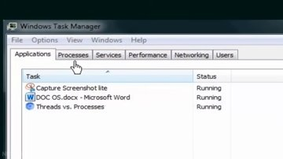

# Process Management (Processes and Threads)

**Source:** Process Management (Processes and Threads) · [YouTube](https://www.youtube.com/watch?v=OrM7nZcxXZU) · **Duration:** 7:32 · **Faithfulness:** 92% of key points supported

## Summary

This lecture provides an introduction to process management in operating systems, focusing on the concepts of processes and threads. Programs written in high-level languages like C, C++, or Java are converted into binary machine code by a compiler. When the operating system loads an executable program into memory and allocates resources, a passive program becomes an active process, defined as a program in execution. The lecture distinguishes between processes and threads, explaining that a process can contain anywhere from a single thread to multiple threads as its fundamental unit of execution. Using practical demonstrations via tools like the Windows Task Manager and Process Explorer, the lecture illustrates how active applications and their underlying system processes—such as multiple instances of chrome.exe or WINWORD.EXE—consume system resources like CPU and memory. Furthermore, it shows how to inspect individual execution threads running inside specific processes using Process Explorer, concluding with a preview of upcoming detailed topics in process management.

## Key points

- ✓ Programs are written in high-level languages like C, C++, or Java and converted into binary machine code by a compiler. [0:00](https://www.youtube.com/watch?v=OrM7nZcxXZU&t=0s) _[speech]_
- ✓ The operating system loads the executable program into memory, allocates resources, and initiates its execution. [0:00](https://www.youtube.com/watch?v=OrM7nZcxXZU&t=0s) _[speech]_
- ✓ A process can be thought of as a program in execution. [0:00](https://www.youtube.com/watch?v=OrM7nZcxXZU&t=0s) _[both]_
- ✓ A process is a program in execution, whereas a thread is the unit of execution within a process. [2:26](https://www.youtube.com/watch?v=OrM7nZcxXZU&t=146s) _[both]_
- ✓ A process can have anywhere from just one thread to many threads. [2:26](https://www.youtube.com/watch?v=OrM7nZcxXZU&t=146s) _[both]_
- ✓ The applications tab in Task Manager shows running programs like Microsoft Word and other utilities. [4:42](https://www.youtube.com/watch?v=OrM7nZcxXZU&t=282s) _[speech]_
- ✓ The Task Manager processes tab lists active system processes alongside resource consumption metrics like memory and CPU. [5:04](https://www.youtube.com/watch?v=OrM7nZcxXZU&t=304s) _[slide]_
- ✓ A single program can have multiple processes associated with it, as seen with multiple chrome.exe instances. [5:10](https://www.youtube.com/watch?v=OrM7nZcxXZU&t=310s) _[both]_
- ✓ Process Explorer is a small downloadable program used to view threads running for each program and process. [5:40](https://www.youtube.com/watch?v=OrM7nZcxXZU&t=340s) _[speech]_
- ? Process Explorer provides a detailed view of system processes and processor usage percentages. [6:02](https://www.youtube.com/watch?v=OrM7nZcxXZU&t=362s) _[both]_
- ✓ Right-clicking a process such as chrome.exe and navigating to properties reveals its threads. [6:18](https://www.youtube.com/watch?v=OrM7nZcxXZU&t=378s) _[speech]_
- ✓ The threads tab lists the specific units of execution running within a selected process. [6:30](https://www.youtube.com/watch?v=OrM7nZcxXZU&t=390s) _[speech]_

## Detailed summary

The lecture begins with an introduction to how software transitions from human-readable source code to active execution under the control of an operating system. Programs written in high-level languages such as C, C++, or Java are compiled into binary machine code. Once compiled, the operating system loads the executable program into memory, allocates necessary computer resources, and initiates its execution. At this point, the passive program transforms into a process, which is fundamentally a program in execution.

Building upon this definition, the lecture explores the relationship between processes and threads. While a process represents an active entity with allocated resources, a thread serves as the basic unit of execution within that process. A process can consist of a single thread or multiple threads operating concurrently.

To make these abstract concepts concrete, the lecture uses the Windows Task Manager to examine running applications and active system processes. The applications tab demonstrates user-facing programs like Microsoft Word and utility tools. Meanwhile, the processes tab lists active image names—such as chrome.exe, WINWORD.EXE, explorer.exe, and dwm.exe—alongside performance metrics including CPU usage and memory consumption. The lecture notes that a single application can spawn multiple processes, as illustrated by Chromium running several chrome.exe instances simultaneously.

Because standard task management interfaces may not always expose low-level execution details clearly, the lecture introduces Process Explorer as an advanced downloadable utility for inspecting system processes and their resource utilization. By right-clicking a specific process (such as chrome.exe) and opening its properties, users can access the threads tab. This tab displays the active execution units running inside that particular process. The session concludes by emphasizing that processes and threads are core pillars of operating system process management, setting the stage for more advanced topics in subsequent lectures.

## Chapters

- [0:00](https://www.youtube.com/watch?v=OrM7nZcxXZU&t=0s) Introduction to Programs and Processes
- [2:26](https://www.youtube.com/watch?v=OrM7nZcxXZU&t=146s) Processes and Threads Fundamentals
- [4:42](https://www.youtube.com/watch?v=OrM7nZcxXZU&t=282s) Windows Task Manager Applications and Processes
- [5:40](https://www.youtube.com/watch?v=OrM7nZcxXZU&t=340s) Process Explorer and Thread Inspection

# Study notes

## Introduction to Processes and Programs
- High-level language programs written in languages like **C**, **C++**, or **Java** are converted into binary machine code by a **compiler**.
- A **compiler** is a tool used to convert high-level language programs into machine code understandable by the computer.
- The operating system loads executable programs into memory, allocates system resources, and starts their execution.
- A **process** is defined as a program in execution, acting as an active entity with allocated computer resources.

## Processes vs. Threads
- A **process** is an active program in execution, while a **thread** is the unit of execution within a process.
- A process can contain anywhere from just a single thread to many threads.

## Monitoring Processes with Windows Task Manager

- The Windows **Task Manager** allows users to view running applications and active system processes.
- The applications tab displays currently running programs such as Microsoft Word and utility tools.
- The processes tab lists active image names alongside performance metrics like memory and CPU usage.
- Examples of image names seen in Task Manager include `chrome.exe`, `WINWORD.EXE`, `explorer.exe`, and `dwm.exe`.
- A single application can spawn multiple processes simultaneously, as demonstrated by multiple `chrome.exe` instances running for Chromium.

## Inspecting Threads with Process Explorer
- **Process Explorer** is a small downloadable program used to view threads running for each program and process, providing detailed views of system processes and processor usage percentages.
- Users can inspect underlying threads by right-clicking a process (such as `chrome.exe`), navigating to its properties, and checking the threads tab.
- The threads tab displays the specific units of execution running within a selected process.

## Glossary

- **Process** — A program in execution, representing an active entity allocated with computer resources by the operating system.
- **Compiler** — A tool used to convert high-level language programs into machine code understandable by the computer.
- **Thread** — The unit of execution within a process.
- **Task Manager** — A Windows utility used to view running applications, active system processes, and resource consumption metrics like memory and CPU.
- **Process Explorer** — A downloadable program used to inspect system processes, processor usage percentages, and individual threads running for each program.
- **High-level languages** — Programming languages such as C, C++, and Java.

## Revision questions

**Q1.** What is a process defined as in the lecture?
   - A) A program in execution
   - B) A compiler output file
   - C) A hardware resource allocation table
   - D) A high-level programming language

Answer
A — The lecture explicitly defines a process as a program in execution.

**Q2.** What tool is used to convert high-level languages like C, C++, or Java into binary machine code?
   - A) Task Manager
   - B) Process Explorer
   - C) Compiler
   - D) Operating System Loader

Answer
C — High-level language programs are converted into binary machine code by a compiler.

**Q3.** How many threads can a single process contain according to the lecture?
   - A) Exactly one thread
   - B) Exactly two threads
   - C) Anywhere from just one thread to many threads
   - D) Always more than ten threads

Answer
C — The lecture notes that a process can have anywhere from just one thread to many threads.

**Q4.** Which tool is specifically introduced as a downloadable program to view threads running for each process?
   - A) Task Manager
   - B) Process Explorer
   - C) Command Prompt
   - D) Device Manager

Answer
B — Process Explorer is described as a small downloadable program used to view threads running for each program and process.

**Q5.** Which of the following is listed as an example of an image name in the Windows Task Manager?
   - A) kernel.sys
   - B) chrome.exe
   - C) word_thread.dll
   - D) java_compiler.obj

Answer
B — The lecture lists chrome.exe, WINWORD.EXE, explorer.exe, and dwm.exe as image names in Task Manager.

**S1.** What happens the moment a passive program begins execution?

Model answer
It becomes an active process.

**S2.** What is the unit of execution within a process called?

Model answer
A thread.

**S3.** Name three high-level languages mentioned in the lecture that are converted into binary machine code.

Model answer
C, C++, and Java.

**S4.** Which tab in Windows Task Manager shows active system processes along with CPU and memory details?

Model answer
The processes tab.

**S5.** Where can you view the specific units of execution running within a selected process in Process Explorer?

Model answer
In the threads tab under the process properties.

---
*Generated by LectureLens · transcript: captions:manual · segmentation: slide-aligned · LLM calls: 2 (cache hits 0) · providers: gemini/gemini-3.5-flash-lite*