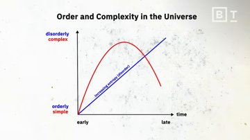

# The physics of entropy and the origin of life | Sean Carroll

**Source:** The physics of entropy and the origin of life | Sean Carroll · [YouTube](https://www.youtube.com/watch?v=Sz1n0RHwLqA) · **Duration:** 6:11

## Summary

The lecture explores the fundamental physics of entropy, the origin of life, and how these two concepts intersect. The second law of thermodynamics establishes that disorder in the universe continuously increases because there are vastly more ways to be disorderly than orderly. This drives systems toward an eventual state of equilibrium known as the heat death of the universe, where overall entropy is maximized and no interesting phenomena remain. However, distinguishing between orderly-disorderly and simple-complex axes reveals that physics also governs the journey toward complex structures. In the context of the origin of life—which involves replication, compartmentalization, and metabolism—the metabolism-first perspective argues that living systems must maintain internal order by consuming low-entropy energy from their environment while accelerating the overall entropy of the universe. This theoretical framework famously predicted and led to the discovery of the hydrothermal 'Lost City' formation at the bottom of the Atlantic Ocean, illustrating how the physics of thermodynamics underpins biological complexity.

## Key points

- Disorder increases as a fundamental feature of reality according to the second law of thermodynamics. [0:11](https://www.youtube.com/watch?v=Sz1n0RHwLqA&t=11s) _[speech]_
- Things tend to go from orderly to disorderly because there are many more ways to be disorderly. [0:11](https://www.youtube.com/watch?v=Sz1n0RHwLqA&t=11s) _[speech]_
- The Heat death of the Universe refers to the eventual state where all engines, burning stars, and living beings maximize the overall entropy. [0:11](https://www.youtube.com/watch?v=Sz1n0RHwLqA&t=11s) _[speech]_
- Equilibrium is defined as a state of maximum chaos where nothing interesting happens anymore. [0:11](https://www.youtube.com/watch?v=Sz1n0RHwLqA&t=11s) _[speech]_
- Simple versus complex and orderly versus disorderly are two different axes of thinking. [1:56](https://www.youtube.com/watch?v=Sz1n0RHwLqA&t=116s) _[speech]_
- The increase of entropy governs the shift from orderly to disorderly but says nothing about simple versus complex. [1:56](https://www.youtube.com/watch?v=Sz1n0RHwLqA&t=116s) _[speech]_
- Life as we know it involves replication, compartmentalization with cell walls, and metabolism. [2:41](https://www.youtube.com/watch?v=Sz1n0RHwLqA&t=161s) _[speech]_
- The replication-first camp argues that genetic information must have come first and hooked up to an energy source. [2:41](https://www.youtube.com/watch?v=Sz1n0RHwLqA&t=161s) _[speech]_
- The metabolism-first camp argues that information cannot be called life if it is not moving around and metabolizing. [2:41](https://www.youtube.com/watch?v=Sz1n0RHwLqA&t=161s) _[speech]_
- Living beings need to feed off low-entropy energy and increase the entropy of the Universe to maintain orderliness and complexity. [2:41](https://www.youtube.com/watch?v=Sz1n0RHwLqA&t=161s) _[speech]_
- The prediction that life formed near hydrothermal vents led to the discovery of the 'Lost City' formation at the bottom of the Atlantic Ocean. [2:41](https://www.youtube.com/watch?v=Sz1n0RHwLqA&t=161s) _[speech]_

## Detailed summary

The lecture begins by examining the second law of thermodynamics, which dictates that disorder in the universe is continually increasing. This happens fundamentally because there are many more ways for a system to be disorderly than orderly. Common everyday examples of this process include ice cubes melting, batteries running out, and cream mixing into coffee. Over long cosmological timescales, this relentless increase in entropy leads to the heat death of the universe—a state of maximum chaos and equilibrium where engines cease to run, stars stop burning, and all living beings succumb to maximum overall entropy, leaving no interesting phenomena remaining.

To better understand these thermodynamic processes, it is essential to distinguish between two different axes of thought: simple versus complex, and orderly versus disorderly. People frequently confuse these categories. While the increase of entropy governs the inevitable transition from orderly to disorderly, it does not directly dictate whether a system is simple or complex. A major ongoing scientific question is how the laws of physics guide matter on a journey from low to high entropy while simultaneously generating complex structures.

Life on Earth exemplifies this interplay. Biological systems require three core components: replication, compartmentalization with cell walls, and metabolism. This has sparked a debate between two schools of thought: the replication-first camp, which argues that genetic information must have originated first and later coupled with an energy source, and the metabolism-first camp, which contends that information alone cannot be considered life if it is not actively moving and metabolizing. Historically, ideas about the origin of life ranged from Darwin's warm pond hypothesis to modern hydrothermal vent theories.

The metabolism-first perspective is deeply rooted in thermodynamics. Living beings are open systems that maintain their internal orderliness and complexity by feeding off low-entropy energy sources and paying the price by increasing the overall entropy of the universe. This profound thermodynamic insight led scientists to predict that life likely formed near hydrothermal vents, a prediction that was triumphantly validated by the subsequent discovery of the 'Lost City' formation at the bottom of the Atlantic Ocean.

## Chapters

- [0:11](https://www.youtube.com/watch?v=Sz1n0RHwLqA&t=11s) Thermodynamics and the Universe
- [1:56](https://www.youtube.com/watch?v=Sz1n0RHwLqA&t=116s) Simple vs Complex vs Orderly
- [2:41](https://www.youtube.com/watch?v=Sz1n0RHwLqA&t=161s) Origin of Life and Metabolism

# Study notes

## Thermodynamics and the Universe

- **Second law of thermodynamics**: Establishes that disorder in the universe continuously increases because there are many more ways to be disorderly than orderly.
- **Equilibrium**: A state of maximum chaos where nothing interesting happens anymore.
- **Heat death of the Universe**: The eventual state where all engines, burning stars, and living beings maximize overall entropy.
- *Examples*: Batteries running out, cream and coffee mixing together, ice cubes melting.

## Simple vs Complex vs Orderly

- **Simple versus complex** and **orderly versus disorderly** represent two completely different axes of thought.
- While the increase of entropy dictates the shift from orderly to disorderly, it does not address whether a system is simple or complex.

## Origin of Life and Metabolism
- Life involves **replication**, **compartmentalization** (with cell walls), and **metabolism**.
- **Replication-first camp**: Argues that genetic information must have come first and subsequently hooked up to an energy source.
- **Metabolism-first camp**: Argues that information cannot be considered life if it is not moving around and metabolizing.
- Living beings must feed off **low-entropy energy** and increase the entropy of the universe to maintain their internal orderliness and complexity.
- *Examples*: Darwin's warm pond idea, the 'Lost City' formation at the bottom of the Atlantic Ocean.

## Glossary

- **Equilibrium** — A state of maximum chaos and nothing interesting happening anymore.
- **Second law of thermodynamics** — The physical law stating that disorder continuously increases because there are more ways to be disorderly.
- **Heat death of the Universe** — The eventual state of the universe where overall entropy is maximized and no interesting phenomena remain.
- **Replication** — A core component of life involving the copying of genetic information.
- **Compartmentalization** — A characteristic of life involving boundaries such as cell walls.
- **Metabolism** — The chemical processes within living beings that involve moving around and processing energy.
- **Low-entropy energy** — Ordered energy that living beings feed off to maintain their internal order and complexity.

## Revision questions

**Q1.** According to the second law of thermodynamics, why does disorder increase in the universe?
   - A) A Because energy is constantly being created
   - B) B Because there are many more ways to be disorderly than orderly
   - C) C Because complex structures naturally decay into simpler elements
   - D) D Because systems actively resist equilibrium

Answer
B — The lecture explicitly states that things tend to go from orderly to disorderly because there are many more ways to be disorderly.

**Q2.** What is the 'Heat death of the Universe' characterized by?
   - A) A A state of maximum chaos and equilibrium where nothing interesting happens
   - B) B The sudden freezing of all stars and galaxies
   - C) C The complete destruction of all matter into pure radiation
   - D) D A continuous cycle of rebirth and destruction

Answer
A — The lecture defines equilibrium and heat death as a state of maximum chaos where nothing interesting happens anymore.

**Q3.** Which two axes of thought are noted as being frequently confused?
   - A) A Mass versus energy and entropy versus enthalpy
   - B) B Simple versus complex and orderly versus disorderly
   - C) C Replication versus metabolism and biology versus physics
   - D) D Equilibrium versus chaos and open versus closed systems

Answer
B — The lecture highlights that people often confuse simple versus complex with orderly versus disorderly, noting they are two different axes of thought.

**Q4.** What is the core argument of the metabolism-first camp regarding the origin of life?
   - A) A Genetic information must have evolved before any energy source was utilized
   - B) B Information cannot be called life if it is not moving around and metabolizing
   - C) C Cell walls formed independently of chemical reactions
   - D) D Replication is the sole defining characteristic of living systems

Answer
B — The lecture states that the metabolism-first camp argues information cannot be called life if it is not moving around and metabolizing.

**Q5.** How do living beings maintain their internal orderliness and complexity?
   - A) A By isolating themselves completely from universal energy fluxes
   - B) B By reversing the second law of thermodynamics locally
   - C) C By feeding off low-entropy energy and increasing the entropy of the universe
   - D) D By destroying genetic information to decrease local heat

Answer
C — The lecture notes that living beings need to feed off low-entropy energy and increase the entropy of the universe to maintain orderliness and complexity.

**S1.** What common everyday examples are cited to illustrate the increase of disorder?

Model answer
Batteries running out, cream and coffee mixing together, and ice cubes melting.

**S2.** What are the three core aspects that life on Earth requires?

Model answer
Replication, compartmentalization with cell walls, and metabolism.

**S3.** What are the two competing camps regarding the origin of life mentioned in the lecture?

Model answer
The replication-first camp and the metabolism-first camp.

**S4.** What specific geological formation at the bottom of the Atlantic Ocean was predicted by metabolism-first theories of life?

Model answer
The 'Lost City' formation.

**S5.** How is equilibrium defined in the context of universal thermodynamics?

Model answer
A state of maximum chaos where nothing interesting happens anymore.

---
*Generated by LectureLens · transcript: captions:manual · segmentation: speech-only · LLM calls: 2 (cache hits 0) · providers: gemini/gemini-3.5-flash-lite*